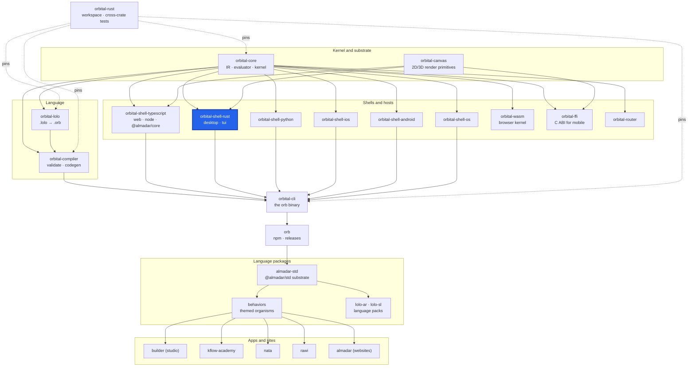

<div align="center">

# orbital-shell-rust

**The Rust shell: generates a native Cargo project that runs a served program on the kernel, plus the desktop, terminal and game clients.**

[](https://github.com/almadar-io/orbital-shell-rust/actions/workflows/ci.yml) [](LICENSE)

</div>

The Rust shell turns a compiled Orbital program into a native Rust project: a host entry that runs the served program, and client entry points (desktop, terminal, game). It also builds `orb-desktop`, a GUI host for programs, from the Dioxus and ratatui renderers it carries.

## Where this fits



| Upstream (this repo depends on) | Downstream (depends on this repo) |
|---|---|
| [orbital-core](https://github.com/almadar-io/orbital-core): IR, evaluator and kernel (`orbital-core-base`, `orbital-core-eval`) | [orbital-cli](https://github.com/almadar-io/orbital-cli): the `orb` binary, which runs this shell as `orb-shell-rust` for `orb compile --shell rust` |
|  | [orbital-shell-python](https://github.com/almadar-io/orbital-shell-python): its native extension (`bridges/native`) depends on this crate |

## Quick start

```bash
orb compile <program.orb> --shell rust -o <out-dir>
cd <out-dir> && cargo check && cargo run
```

## How `orb compile --shell rust` uses it

`orb` runs the `orb-shell-rust` program. It scaffolds `templates/rust-shell` (binaries `desktop`, `terminal`, `game`) and writes the served program for the host. The generated app runs on the native Rust kernel, `orbital-core`, through this crate's `host` module; the desktop client also depends on `orbital-core` with the `client-http` feature and on the Dioxus and TUI renderers in this repo. The template's `Cargo.toml` consumes these crates by relative path, so a generated app must be emitted inside the `orbital-rust` workspace (two levels under its root). The `renderer` option accepts `all`; `tui` is rejected as deferred (G-CROSS-290).

## Layout

| Path | Contents |
|---|---|
| `src/` | The crate: codegen (`desktop`, `game`, `server`, `tui`), shell, `orb-shell-rust` program, `orb-desktop` binary |
| `templates/rust-shell/`, `templates/rust-terminal/` | Project scaffolds the shell copies into every generated app |
| `renderers/dioxus/`, `renderers/tui/` | GUI (Dioxus) and terminal (ratatui) renderers |
| `hosts/` | `native`, `desktop`, `terminal`, `web`, `browser` host sources |
| `runtime/` | Dioxus runtime sources |
| `tests/` | `desktop_program.rs` and fixtures |

`orb-desktop` is behind the `desktop` Cargo feature (`required-features = ["desktop"]`).

## Development

The crate reads the Almadar language data (patterns, operators, themes, vocabularies) from the installed npm packages, so install those first (this is the CI recipe):

```bash
npm install --no-save --no-package-lock @almadar/core@^10 @almadar/std@^16 @almadar/lolo-ar@^1 @almadar/lolo-sl@^1
cargo test
```

Open gaps are tracked in [Almadar_Gaps.md](Almadar_Gaps.md). Work on `main`; never create a feature branch.

## Docs

- [Orb documentation](https://orb.almadar.io/docs): the language, the `orb` CLI and how the pieces fit

## License

[Business Source License 1.1](LICENSE): free for non-commercial and evaluation use; converts to Apache-2.0 on the change date.
